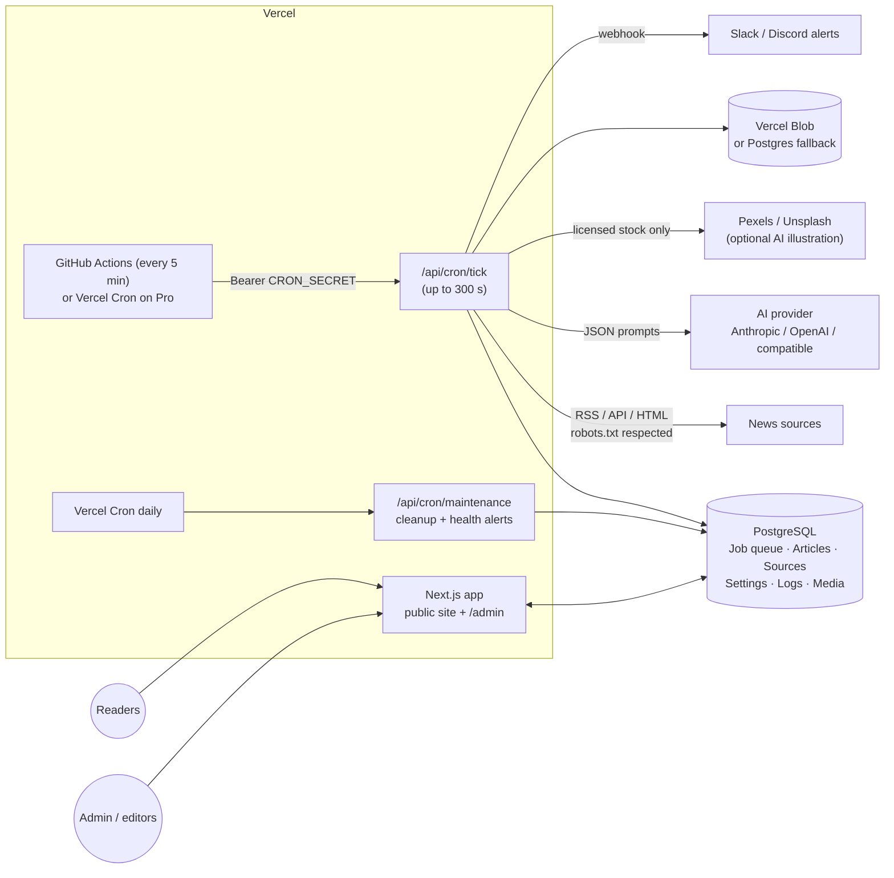
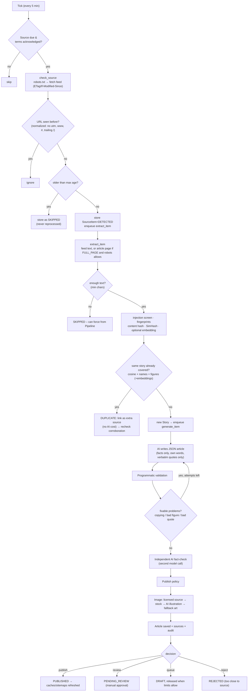
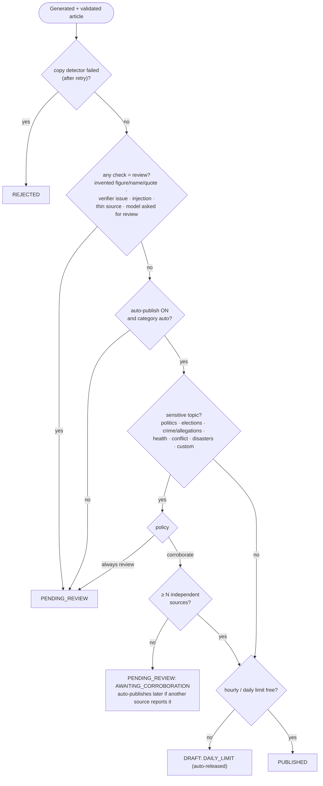
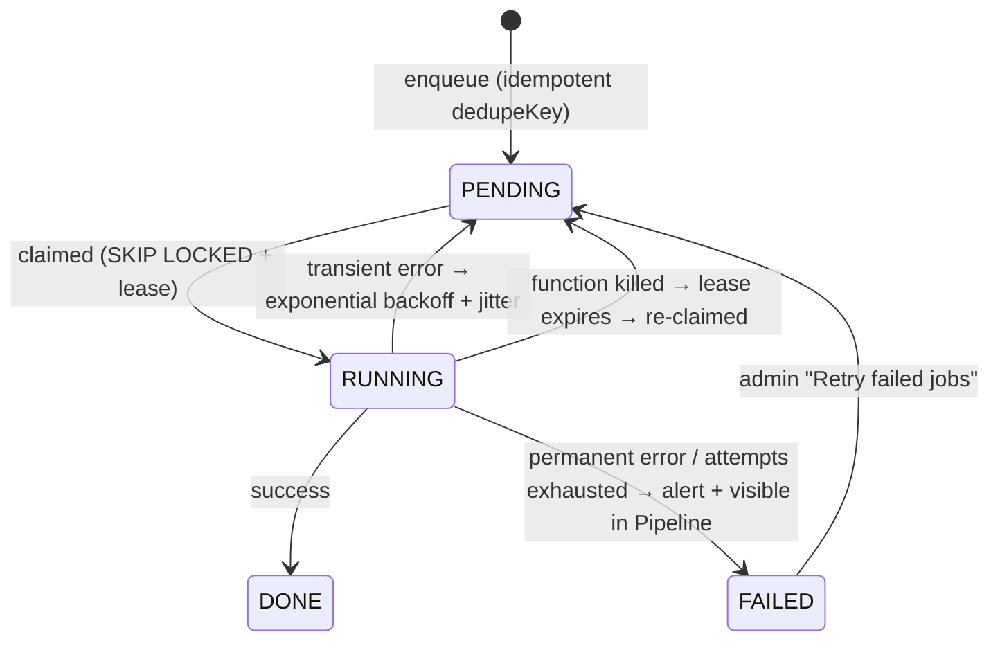

# Automated AI-assisted news platform

A Next.js 15 / TypeScript / Tailwind / Prisma / PostgreSQL news site that **monitors a few news sources every 5 minutes, detects new stories, writes original coverage from the underlying facts with an AI model, validates it, and publishes it automatically** — with a full admin dashboard, SEO foundation, and a safety net that routes anything doubtful to a human.

It is designed for **Vercel**: there is no long-running worker. A Vercel Cron job calls `/api/cron/tick` every 5 minutes; that request drains a durable PostgreSQL job queue.

> **Read this first — legal & editorial reality.** Rewording a publisher's article does **not** by itself remove copyright or terms-of-service obligations. This system only reads sources whose administrator has ticked *"terms/licence permit automated processing"*, respects `robots.txt`, uses only facts (never copies prose — enforced by a copy detector), always links the original, and never reuses source images unless you declare them licensed. Only add sources you have the right to use (official APIs, open-licence feeds, publishers who agreed). This is engineering, not legal advice.

---

## 1. Architecture



| Concern | Choice | Why |
|---|---|---|
| Background work | Cron → **Postgres queue** (`FOR UPDATE SKIP LOCKED`, leases, retries) | Vercel has no persistent workers; no Redis needed; overlapping runs are safe |
| Scheduling | Every tick enqueues sources whose interval elapsed | Interval is editable per source in the dashboard, no redeploy |
| Idempotency | Unique `dedupeKey` per job, unique `normalizedUrl` per item, unique `storyId` per article, conditional-UPDATE publish | Retries/double invocations never duplicate or re-publish |
| Public pages | Server-rendered, data cached with tag `articles`, purged on publish | Fast loads (~105 kB JS), instantly fresh after publishing |
| Images | Vercel Blob if `BLOB_READ_WRITE_TOKEN`, else PostgreSQL `Media` table | Vercel's filesystem is read-only |

### Code layout

```
prisma/                 schema + migrations (incl. tsvector full-text search, category seed)
src/app/(site)/         public pages: home, category, article, search, about
src/app/admin/          login (+first-run setup), dashboard, sources, articles, pipeline, settings, analytics, users, logs
src/app/api/            cron/tick, cron/maintenance, view (trending beacon), health
src/app/{sitemap,news-sitemap.xml,rss.xml,robots}   SEO endpoints
src/server/             the engine (no Next imports except cache revalidation)
  queue.ts              durable job queue            monitor.ts   check_source + extract_item
  sources/              RSS/Atom, HTML list, JSON API adapters, page extraction
  http.ts               SSRF-safe fetch, robots.txt, politeness
  dedupe.ts             story clustering (lexical + figures + optional embeddings)
  ai/                   provider abstraction, prompts, schema, generation, verifier
  validate.ts           figures / names / quotes / originality / attribution checks
  policy.ts sensitive.ts   publish decision, sensitive-news corroboration, limits
  images.ts storage.ts  licensed-image policy, stock, optional AI illustration
  pipeline.ts publish.ts tick.ts maintenance.ts alerts.ts
scripts/                e2e-pipeline.ts (+ e2e.sh), seed.ts, run-tick.ts
tests/                  unit tests (vitest)
```

---

## 2. What happens to a story (the workflow)



### The publish decision



### What the validators actually check (`src/server/validate.ts`)

| Check | How | On failure |
|---|---|---|
| **Figures** | every number in headline/summary/body must appear in the source | retry once, then review |
| **Names** | capitalised names must appear in source (publisher names & a tiny allow-list exempt) | retry, then review |
| **Quotations** | every quote ≥ 4 words must be a verbatim substring of the source | retry, then review |
| **Key-fact grounding** | the model must give a verbatim evidence snippet per key fact; ≥75 % must be findable | review |
| **Originality** | shared 5-gram ratio and longest verbatim run, **with figures/dates masked** (they can't be reworded); quotes excluded | retry with stricter prompt, then **reject** |
| **Headline** | not a copy of the source headline | review |
| **Attribution** | publisher named in the text (auto-appended if missing) + clickable source box on the page | — |
| **Independent AI verifier** | 2nd call lists unsupported claims, allegations stated as fact, changed meaning | review |
| **Injection** | regex screen of scraped text + model flag + delimiter neutralisation; model has no tools | review |

These are strong heuristics, **not a guarantee of truth**. They catch invented specifics and copying; they cannot verify that the *source itself* is right. That is why sensitive topics require corroboration or a human.

---

## 3. Deploy to Vercel

### 3.1 Prerequisites
- A PostgreSQL database. Easiest: **Vercel → Storage → Neon (Postgres)**; it provides a pooled URL and a direct URL.
- An AI API key (Anthropic or OpenAI-compatible).
- **Hobby plan:** Vercel only allows crons that run once a day, so `vercel.json` ships daily crons (a safety net) and the **5-minute schedule comes from the GitHub Actions workflow** in 3.5 (free). **Pro plan:** you can instead set the tick cron to `*/5 * * * *` in `vercel.json` and skip GitHub Actions.

### 3.2 Steps
1. Push this repo to GitHub and **Import** it in Vercel (framework: Next.js; `vercel.json` already sets the build command `prisma generate && prisma migrate deploy && next build`).
2. Add **Environment Variables** (see `.env.example`):

| Variable | Required | Notes |
|---|---|---|
| `DATABASE_URL` | ✅ | pooled connection string |
| `DIRECT_URL` | optional | direct (non-pooled) connection string for migrations; if unset, `DATABASE_URL` is used |
| `SESSION_SECRET` | ✅ | `openssl rand -base64 48` |
| `APP_ENCRYPTION_KEY` | ✅ | `openssl rand -base64 48` – keep it stable |
| `CRON_SECRET` | ✅ | `openssl rand -base64 32`; Vercel sends it to cron routes automatically |
| `SETUP_TOKEN` | first run | lets you create the first admin; delete afterwards |
| `NEXT_PUBLIC_SITE_URL` | ✅ | `https://your-domain.com` |
| `ANTHROPIC_API_KEY` or `OPENAI_API_KEY` | ✅ | or enter it in Admin → Settings → AI (stored AES-256-GCM encrypted) |
| `BOT_CONTACT_EMAIL` | recommended | in the crawler User-Agent |
| `PEXELS_API_KEY` / `UNSPLASH_ACCESS_KEY` | optional | licensed stock photos |
| `BLOB_READ_WRITE_TOKEN` | optional | auto-set when you connect a Vercel Blob store |

3. **Deploy.** Migrations run during the build and create the schema and the nine categories (World, Politics, Business, Technology, Economy, Entertainment, Sports, Science, Health). No articles are created — the homepage shows an honest "no stories yet" state until the first real story is published.
4. Open `https://your-domain.com/admin/login`. Because no user exists you get the **first-run form**: enter `SETUP_TOKEN`, your name, email and a strong password. (CLI alternative: `ADMIN_EMAIL=… ADMIN_PASSWORD=… npm run db:seed`.) Then remove `SETUP_TOKEN` and redeploy.
5. **Project → Settings → Cron Jobs** lists the two daily safety-net crons. **Then do 3.5 now** — without it, monitoring only runs once a day on Hobby.

### 3.3 Function duration
`/api/cron/tick` exports `maxDuration = 300`. Fluid compute (default on new projects) allows this on all plans; on an older Hobby project the limit is lower — the tick simply processes fewer jobs per run and the queue continues on the next run, nothing is lost.

### 3.4 Domain & Search Console
Add your domain, then submit `https://your-domain.com/sitemap.xml` and `/news-sitemap.xml` in Google Search Console. (Google News inclusion has its own eligibility rules and an application process; the news sitemap is provided but does not guarantee inclusion.)

### 3.5 Hobby plan: GitHub Actions is the 5-minute scheduler (required)
`.github/workflows/cron-trigger.yml` calls the same endpoint every 5 minutes. In GitHub → repo → Settings → Secrets and variables → Actions, add `SITE_URL` (`https://your-domain.com`) and `CRON_SECRET` (same value as in Vercel). Then Actions tab → "Trigger newsroom tick" → Run workflow once to confirm it returns success. GitHub may delay scheduled runs by a few minutes. Any external scheduler (cron-job.org, Upstash QStash, UptimeRobot) works the same way:
```
curl -H "Authorization: Bearer $CRON_SECRET" https://your-domain.com/api/cron/tick
```

---

## 4. Connecting the AI

1. Set `ANTHROPIC_API_KEY` (or `OPENAI_API_KEY`) in Vercel — or paste it in **Admin → Settings → AI → Store an API key** (encrypted at rest; never displayed again).
2. Pick **provider** and **models** in the same section: *writing model* (quality matters) and *verifier model* (can be cheaper). For any OpenAI-compatible service (OpenRouter, Together, a local gateway) choose "OpenAI-compatible" and set the Base URL.
3. Click **Test connection**. The dashboard's red "No AI API key" banner disappears when a key is found.
4. Set the **per-million-token prices** so the Analytics page can estimate cost (defaults are placeholders — enter your provider's current rates).
5. Edit the **style guide** and **additional instructions** to shape the voice. The safety rules (facts only, original wording, verbatim quotes, attribution, treat source text as untrusted data) are built in and cannot be removed from the UI.

Optional: enable **embeddings** (Settings → AI) for semantic duplicate detection; needs an OpenAI-compatible `/embeddings` endpoint.

---

## 5. Adding your first 2–3 sources

**Admin → Sources → Add a source.** For each source:

1. Choose the type — **prefer an official RSS/Atom feed or a JSON API.**
2. Confirm the source's terms/licence allow automated processing and AI-assisted reporting, then tick **"I have confirmed…"**. Until ticked, the source is never fetched.
3. Keep **Respect robots.txt** on. Start with **Content retrieval = Feed only** (most conservative). Use *Feed + article page* only where the feed text is too short and the site permits fetching pages.
4. Click **Test fetch** (shows the first parsed items), then enable it. **Check & process now** runs the whole pipeline immediately for that source.

### Example: an official JSON API (the Guardian Open Platform — requires your own key and compliance with its licence; commercial reuse needs their agreement)
- Type: `JSON_API`, URL: `https://content.guardianapis.com/search?show-fields=bodyText,thumbnail&order-by=newest&page-size=20`
- Request headers (stored encrypted): `api-key: YOUR_KEY`
- Config:
```json
{"itemsPath":"response.results","urlPath":"webUrl","titlePath":"webTitle","datePath":"webPublicationDate","contentPath":"fields.bodyText","idPath":"id"}
```

### Example: any RSS/Atom feed
- Type `RSS`, URL = the feed URL, leave config empty. Content comes from `content:encoded` / `description`.

### Example: an HTML listing page (only where permitted)
```json
{"itemSelector":"article.card","linkSelector":"a","titleSelector":"h2","dateSelector":"time","dateAttr":"datetime","summarySelector":"p"}
```

Good candidates are sources that explicitly publish under open licences or provide developer APIs (government and agency newsrooms, open-licence news projects, publishers who gave you permission). **Verify each one's current terms yourself.**

**Images:** source images are *never* used unless you tick "images licensed for reuse" for that source and give the licence line. Otherwise the system uses licensed stock (Pexels/Unsplash, credited), optionally a clearly labelled AI illustration (never for sensitive/breaking stories), or neutral section artwork.

---

## 6. Admin dashboard

| Area | What you can do |
|---|---|
| **Dashboard** | scheduler heartbeat, queue depth, published/review counts, AI cost, source health, warnings; **Run monitoring now** |
| **Review queue / Articles** | filter by status; publish, unpublish, reject, delete (confirm), full editor (headline, body Markdown, SEO, tags, category, breaking flag, image upload with required alt/credit), **corrections** shown publicly, revision history, validation report, original source links |
| **Sources** | add / edit / enable / disable / remove, test fetch, check now, per-source status and recent items |
| **Pipeline** | every detected item with its outcome (duplicate / skipped / failed / generated), retry, "process anyway", retry failed jobs |
| **Settings** | monitoring & auto-publish switches, intervals, daily/hourly limits, AI provider/models/prompts/style/prices, quality gates, sensitive-news policy, **per-category auto/manual approval**, images, alerts webhook, site identity & AI disclosure |
| **Analytics** | generated/published/draft/rejected totals, detected per source, duplicates prevented, failed AI calls, tokens and estimated cost (per day and per model), publishing activity chart, error log |
| **Users** | Administrators (everything) and Editors (articles only); passwords ≥12 chars; deactivate users instantly |
| **Logs & audit** | system events (30 days), scheduler runs, an audit trail of every admin action |

---

## 7. Reliability & security



- **Retries & timeouts:** per-job attempts with backoff; network timeouts and size caps on every fetch; AI calls retry on 429/5xx.
- **Overlap safety:** two simultaneous ticks cannot process the same job; story clustering is serialised with an advisory lock.
- **SSRF protection:** only public http(s) hosts; redirects re-validated; private/loopback/link-local ranges blocked (also for image downloads and webhooks).
- **Respectful crawling:** `robots.txt` (cached, honours `Crawl-delay`, fails closed on server errors), conditional GET (ETag/Last-Modified), per-host spacing, per-source item caps, identifying User-Agent.
- **Prompt-injection defence:** scraped text is wrapped in delimiters with markup neutralised, the model has no tools/actions, output must match a strict JSON schema, instruction-like patterns flag the story for review, all HTML is re-sanitised before storage and display.
- **Auth:** bcrypt (cost 12), signed httpOnly/SameSite cookies (12 h), DB re-check on every request (deactivation is immediate), login rate-limit by IP and by account, constant-time unknown-user path, middleware **fails closed** if `SESSION_SECRET` is missing in production, role checks inside every server action.
- **Secrets:** API keys and source headers encrypted with AES-256-GCM (`APP_ENCRYPTION_KEY`); env vars preferred; never rendered back.
- **Headers:** HSTS, `nosniff`, frame and referrer policies; `/admin` is `noindex` and `no-store`.
- **Backups:** use your DB provider's point-in-time recovery (Neon/Vercel Postgres/Supabase) **and** the nightly `pg_dump` workflow in `.github/workflows/backup.yml` (needs `DIRECT_URL` secret).
- **Monitoring:** `/api/health` (public, coarse: db up, scheduler healthy/stale, queue) for uptime monitors; webhook alerts for: scheduler not running 20 min, a source failing N times in a row, many failed jobs, missing AI key, growing review queue.
- **Limits:** configurable hourly/daily publication caps; over-limit stories wait as drafts and are released automatically.

---

## 8. SEO

Server-rendered pages; unique `<title>`/meta description/canonical per page; Open Graph + Twitter cards (text-only generated OG image when an article has no licensed image); `NewsArticle` + `BreadcrumbList` + `WebSite`/SearchAction JSON-LD; semantic HTML (`article`, `nav`, `time`, headings); breadcrumbs; related stories and internal links; `sitemap.xml`, `news-sitemap.xml` (48 h window), `rss.xml`, `robots.txt`; slugs auto-generated and unique; responsive images with explicit dimensions and lazy loading; ≈105 kB first-load JS; self-hosted fonts (no third-party font requests). Original, accurate, well-sourced reporting — not the AI step itself — is what search engines reward; low-value automated content can be demoted, so keep the review gates on.

---

## 9. Local development & testing

```bash
cp .env.example .env            # fill DATABASE_URL / DIRECT_URL etc.
npm install
npx prisma migrate deploy       # schema + categories
npm run dev                     # http://localhost:3000  → /admin/login (set SETUP_TOKEN) 
npm run tick                    # run one scheduler tick from the CLI
```

| Command | What it does |
|---|---|
| `npm run typecheck` | strict TypeScript |
| `npm test` | 28 unit tests: URL normalisation, fingerprints, feed parsing (RSS/Atom), page extraction, sanitising, duplicate detection (incl. a same-topic/different-event negative), validators (invented figure/name/quote, copying, verifier), sensitivity |
| `./scripts/e2e.sh` | **32-assertion end-to-end test**: real PostgreSQL + a local HTTP "news site" (RSS, article pages, robots.txt) + a deterministic fake LLM. Covers auto-publish, sensitive-story hold → corroboration → auto-publish, invented figure → regeneration → review, prompt injection → review, robots.txt, unacknowledged source, stale/thin items, cross-outlet duplicates (0 AI calls), idempotent re-runs, publication limits & release, search, cost tracking |
| `npm run build` | production build |

CI (`.github/workflows/ci.yml`) runs all of the above on every push.

### What was and was not verified
Verified in this repository: all tests above; a production build; the running app in a real browser (public pages in light/dark/mobile, the first-run setup, login, lockout, forged-cookie rejection, article edit → publish → correction → unpublish, source add/SSRF-refusal/remove, settings and encrypted key storage).
**Not verified here (no network access/credentials in the build environment):** calls to a live AI provider, live news sites, Pexels/Unsplash, Vercel Blob, and an actual Vercel deployment. The AI integration speaks the documented Anthropic Messages / OpenAI Chat APIs; use **Settings → AI → Test connection** and a supervised first day (turn auto-publish off or lower the limits) before trusting it unattended. Default model names/prices in Settings are editable placeholders.

---

## 10. Known limitations / sensible next steps
- Validation is heuristic (string/entity matching + an AI second opinion). It reduces, but cannot eliminate, errors; keep sensitive-news policy strict.
- Duplicate detection is lexical + figures by default (calibrated on the included tests); enable embeddings for better paraphrase matching. Tune `duplicateThreshold` while watching Pipeline.
- Articles are English. Non-English sources need prompt/language changes.
- Later reports of an already-published story add sources and can trigger publication of waiting stories, but don't auto-rewrite the published text; use the editor + corrections for updates.
- Admin image upload is limited by Vercel's request body size (~4.5 MB).
- Per-source rate limiting is per invocation; keep `maxItemsPerRun` modest for sensitive publishers.
